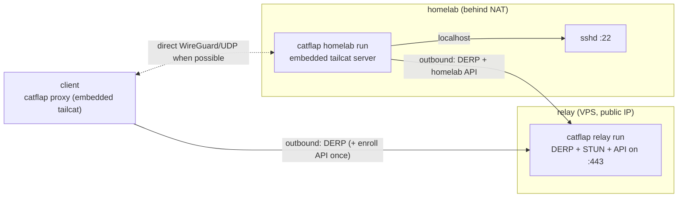

# catflap design

How catflap works and why, for contributors and reviewers. It describes the current release.
For using catflap, see the [user guides](../README.md#documentation); for building and testing,
see [CONTRIBUTING.md](../CONTRIBUTING.md).

## Goals

- **One binary**, `catflap`, that sets up every role: relay, homelab, client.
- **Three commands** for the whole setup: `catflap setup relay`, `catflap setup homelab`,
  `catflap enroll`.
- **Nothing to run besides catflap**: no separate relay server build, no tailcat install, no
  notification server, no tunnel provider.
- **Works in locked-down networks**: everything a client needs goes over TCP 443.
- **No inbound path to the homelab**, and no party besides your own relay in the trust path.

Non-goals: a GUI, multiple relays per homelab, running the relay anywhere but Linux.

## Concepts

| Term | Meaning |
|---|---|
| **relay** | catflap on a VPS with a public address: a DERP relay and catflap's HTTP API on 443/tcp, a STUN server on 3478/udp |
| **homelab** | catflap on the machine you want to reach: a tailcat server that accepts only enrolled devices and forwards chosen ports to local services |
| **client** | catflap on a device you connect from: enrolls once, then tunnels `ssh` and port forwards to the homelab |
| **tailcat** | Tailscale's Go library for a WireGuard tunnel between a client and a server, without Tailscale's coordination server. catflap embeds it on the homelab and clients. |
| **DERP** | Tailscale's relay protocol: devices that can't reach each other directly exchange encrypted WireGuard packets through a DERP server over HTTPS. The relay embeds Tailscale's DERP server. |
| **STUN** | lets a device learn its public address, so homelab and client can try a direct UDP path instead of the relay |
| **node key** | a device's WireGuard public key; the relay and the homelab identify devices by it |
| **tailcat address** | what a client needs to reach the homelab: the homelab's public key, a pre-shared key (PSK) and the relay's host and port. Whoever has it can attempt a WireGuard handshake, so catflap keeps it secret and delivers it only encrypted. |
| **join code** (`cfj1-…`) | one-time secret from the relay that registers a homelab |
| **homelab token** | the bearer token a registered homelab uses for the relay API. The relay API calls a registered homelab an "agent" (`/v1/agent/…`). |
| **invite** (`cfi1-…`) | one-time secret from the homelab that lets one device enroll |
| **request window** | a period in which devices may ask to join without an invite and are approved by tapping a button |
| **control socket** | the homelab daemon's local unix socket; `catflap invite`, `list`, `forward` etc. talk to the daemon through it |
| **catflap agent** | on a client: a background process that shares one tunnel per homelab among all of the device's connections. Unrelated to the relay API's "agent". |

## Roles and platforms

| Role | Command | Platforms | Runs as |
|---|---|---|---|
| relay | `catflap setup relay` | Linux with systemd | system service, dedicated user `catflap` |
| homelab | `catflap setup homelab` | Linux with systemd, macOS, Windows (see [service per OS](#homelab-service-per-os)) | your normal user, no root (Windows administrator accounts: with admin rights) |
| client | `catflap enroll` | Linux, macOS, Windows | your normal user, no service |

CPU architectures: see the [release contents](releasing.md#what-a-release-contains).

The **homelab is the admin**: `catflap invite`, `list`, `remove` run there. After `setup relay`,
nobody needs root on the relay for day-to-day work.

The full command list is `catflap help`; `catflap <command> -h` shows a command's options.

## Why Go, and what is embedded

- **tailcat is a Go library** (`github.com/tailscale/tailcat`). catflap embeds it on the homelab
  (server) and on clients (dialer), so there is no separate tailcat install. tailcat ships no
  macOS binary, which embedding also solves.
- **tailcat's `Server.AllowClient` hook** asks catflap about each new client at connect time.
  Adding or removing a device changes an in-memory set: no restart is needed, and there is never
  a moment where the server accepts everyone. `Server.DisconnectClient` cuts off a removed
  device right away. These hooks need a tailcat newer than v0.7.0 (see
  [releasing](releasing.md#dependencies)).
- **The DERP server is embedded** in the relay (`tailscale.com/derp/derpserver` +
  `tailscale.com/net/stunserver` + Let's Encrypt via `autocert`). DERP, the enrollment API and
  the homelab API share **port 443**. The relay needs no Go toolchain and no separate build.
  - Cost: catflap owns the ~200 lines of glue that upstream `cmd/derper` (Tailscale's standalone
    DERP server) contains: TLS, timeouts, the meta certificate. catflap copies upstream's
    settings and keeps them in step when it bumps `tailscale.com`.
  - tailcat already depends on `tailscale.com`, so both sides always use the same version.
- Static builds (`CGO_ENABLED=0`) for all seven targets via goreleaser. 32-bit ARM is built for
  ARMv6 (`GOARM=6`), which also runs on ARMv7: every Raspberry Pi with a 32-bit OS, down to Pi 1
  and Zero.

## Big picture



## Security model

Three independent gates, plus the secret address:

| Gate | Where | Decides |
|---|---|---|
| 1 relay admission | relay, in-process | may this node key use the relay at all? |
| 2 tailcat allowlist | homelab, `AllowClient` hook | may this node key open a tunnel? |
| 3 SSH keys | homelab sshd, `authorized_keys` | may this person log in? |
| + PSK | tailcat address | only holders of the (secret) address can handshake |

**The relay never decides on its own who gets in.** It admits keys at gate 1 only when an
authenticated homelab says so. Gates 2 and 3 live on the homelab. A fully compromised relay can
let strangers use the relay itself, but it can't add a device to your homelab, and it can't read
invites or the homelab address.

### Bootstrap: join code (relay → homelab)

1. `setup relay` generates a **join code** `cfj1-<id>-<secret>@relay.example.com`: 128-bit
   secret, one use, valid 1 h. The relay stores only `sha256(secret)`.
2. `setup homelab --join <code>` calls `POST /v1/agent/join` with the secret and the homelab's
   tailcat node key.
3. The relay creates a record for the homelab and returns a random 256-bit **homelab token**. It
   keeps only the token's hash and admits the homelab's node key at gate 1.
4. The homelab stores the token (mode 600). Every homelab API call uses
   `Authorization: Bearer <token>`.

A new join code: `sudo catflap relay join-code` on the relay.

### Enrollment: invite codes (default)

```
homelab$ catflap invite office-laptop           # default: valid 15 min, one use
laptop$  catflap enroll cfi1-<id>-<secret>@relay.example.com
```

`catflap invite` creates the invite on the homelab and registers only its id and expiry with the
relay (`POST /v1/agent/invites`; `invites --revoke` calls `DELETE /v1/agent/invites/{invite}`).

Crypto (all keys from the invite's 128-bit `secret` via HKDF-SHA256, salt `catflap-invite-v1`):
- `mac_key = HKDF(secret, info="mac")`, `seal_key = HKDF(secret, info="seal")`
- The client sends `POST /v1/enroll {invite_id, nodekey, ssh_key, hostname, nonce, mac}` where
  `mac = HMAC-SHA256(mac_key, "catflap-enroll-v1\n" + invite_id + "\n" + nodekey + "\n" + ssh_key + "\n" + hostname + "\n" + nonce)`.
- The relay **does not know the secret**. It only checks that `invite_id` was registered by a
  homelab and is still open, then queues the submission (max 5 per invite).
- The homelab picks up the submission (long poll on `GET /v1/agent/events`), verifies the MAC,
  and enforces one use and the expiry. Then, in this order:
  1. Gate 2: add the node key to the live allowlist.
  2. Gate 3: add the SSH key to `authorized_keys`, tagged `catflap:<name>`.
  3. Answer `POST /v1/agent/result`, which atomically admits the key at gate 1, closes the
     invite, and stores a **sealed reply** for the client.
- Sealed reply = AES-256-GCM(`seal_key`) over `{name, tailcat address, ssh user}`, with the
  invite id, submission id and node key as associated data. The client polls
  `GET /v1/enroll/<invite>/<submission>`, decrypts, and thereby knows the reply really came from
  the homelab.

What this buys:
- **No human code comparison.** The MAC binds the keys end to end, so a relay or proxy that
  swaps keys fails verification.
- **The tailcat address never travels in clear** and is never published anywhere (e.g. in DNS),
  so the PSK stays secret.
- **No third party** in the trust path.

Residual risks (documented for users):
- **An invite is a bearer secret until it's used.** Whoever enrolls first with it gets the slot,
  which is why invites are short-lived, one use and bound to a name. `catflap list` shows every
  device. `catflap invites` lists and revokes open invites.
- **Long-lived invites** (`--ttl 30d`, for emergencies) belong in a password manager only.

### Notifications and the Telegram invite bot

For "new laptop, away from home, only my phone at hand", and to notice when something happens
that you didn't do.

Sending a notification is easy; a way back to the homelab is the hard part. An approve button in
a notification would need an inbound path to the homelab (a public endpoint or tunnel) and would
let anyone who can read the notification add a device. catflap opens nothing: every channel is
an outgoing HTTPS request from the homelab, and the bot long-polls Telegram.

- **Channels** (`catflap notify add …`, homelab only): `ntfy` (ntfy.sh or your own server; a
  random topic name is suggested because ntfy.sh topics are readable by name; optional access
  token), `pushover`, `telegram`, and `command` (runs a program of your choice, no shell, with the
  message on stdin and `CATFLAP_EVENT/TITLE/MESSAGE/PRIORITY` in the environment, e.g. for mail).
  Channels are compiled in; a new kind of channel is a new channel type in the code.
  - Stored in `notify.json` next to the homelab state (600, it holds tokens). Tokens are only
    ever read from a prompt or stdin, never from the command line, and never printed.
  - A channel goes live only after its test message got through (`notify add` sends one;
    `notify test` re-checks all).
  - Messages go out in the background with three attempts per message, so a broken channel never
    holds up the homelab. Errors never contain the Telegram URL (it holds the bot token).
- **Alerts**, to every channel: device enrolled (high priority, with the remove command), device
  removed, invite created, **failed enrollment** (tampered, expired or reused invite: someone
  trying something), relay unreachable for 10 minutes and reachable again, and a stranger writing
  to the bot. A request that came from the bot is answered in Telegram, so its alert goes only to
  the other channels.
- **Telegram invite bot:** `/invite <name>`, `/invites`, `/revoke <name>`, `/list`,
  `/remove <name>`, `/requests`, `/status`.
  - **One chat only.** `notify add telegram` links the chat that opens
    `t.me/<bot>?start=<one-time code>`; a stranger can't link instead. Everyone else is ignored,
    and the first message per stranger per hour triggers a high-priority alert on all channels.
  - Bot invites are valid for **15 minutes**. The reply shows `catflap enroll <code>` in a code
    block (tap to copy). Once used, the bot edits the message to "used"; when the invite expires
    or is revoked, it deletes the message.
  - `/remove` asks first (inline buttons, valid 5 minutes, single use): a stolen laptop can be
    cut off from the phone in seconds.
  - Commands that arrived while the homelab was offline (older than 2 minutes) are not executed;
    the bot says so.
  - **What Telegram sees:** bot chats aren't end-to-end encrypted, so Telegram can read the
    invite. It works once, for 15 minutes, and is deleted after use. A Telegram account takeover
    could mint invites, which is why the alerts on your other channels matter: configure ntfy or
    Pushover too, and you see every invite and enrollment there.
  - Nothing changes on the relay or the clients.

### Re-enrolling and moving to another relay

- **Re-enroll invites** (`invite --replace`): an invite flagged `replace` may enroll a device
  under the name of an existing one. On approval the homelab removes the old device's
  `authorized_keys` line, its key from the allowlist (and disconnects it), adds the new device
  under the same name, and syncs the relay (which drops the old key). A plain invite for an
  existing name is still refused.
- **`homelab move --join CODE`** (new relay hostname or port; a same-hostname move is a relay
  backup/restore instead): the tailcat address contains the relay's host and port, so every
  client needs a new address.
  - With the service stopped, the homelab registers with the new relay **with its existing node
    key** and creates one re-enroll invite per device (registered at the new relay; default
    24 h).
  - It then switches `homelab.json` (only its `relay` key) and its state (new homelab token, old
    open invites dropped), de-registers from the old relay and starts again; the bot posts the
    invites if it runs.
  - If registering the invites fails, the new relay record is removed and nothing changed
    locally.
  - It refuses to run through a catflap session, which the restart would end before the invites
    are shown.
- Clients need nothing new: `enroll` with an existing alias replaces the entry (new key, new
  address, ssh config block rewritten).

### Tap-to-approve enrollment (enrollment requests)

No invite: `catflap enroll --request HOMELAB@RELAY [--name N]`, the user compares a 6-digit
pairing code and approves.

- **Request window.** Off by default. `catflap requests on [--for 1h]` or `/requests on [1h]`
  opens it (max 7 days); the homelab tells the relay (`POST /v1/agent/requests {until}`), which
  refuses requests outside it. A restarted homelab closes it (announced at start and after
  outages).
- **Approval only in Telegram (inline buttons, the bot's one chat) or with
  `catflap approve CODE` on the homelab.** Never through the relay, ntfy or Pushover: approval
  links would turn "can read the notification" into "can add a device". All channels still get
  the request with its code.
- **Protocol** (the relay passes everything, decides nothing):
  1. Device → relay `POST /v1/request {homelab, name, nodekey, boxkey, ssh_key, hostname, commit}`;
     `commit = SHA-256("catflap-request-commit-v1\n" + reveal)` over a random 32-byte secret;
     `boxkey` is a fresh X25519 key. The relay answers with an id and the homelab's node key as
     it knows it.
  2. Homelab (event `new`): validates (name free, keys well-formed), answers with a random
     32-byte nonce (`POST /v1/agent/request`; all of the homelab's answers use this route).
  3. Device: fetches the nonce (it polls `GET /v1/request/{id}` throughout), then reveals its
     secret (`POST /v1/request/{id}/reveal`; the relay and the homelab check it against the
     commit).
  4. Both compute the **pairing code**: SHA-256 over length-prefixed fields (homelab key, homelab
     name, device name, node key, box key, SSH key, hostname), the secret and the nonce, reduced
     to 6 digits. The device prints it; the homelab shows it in Telegram (with Approve/Deny) and
     in alerts.
  5. On approval the homelab adds the device (gates 3 and 2, as for invites), seals
     `{name, address, ssh user}` to the box key (NaCl sealed box) and posts it with the approval;
     the relay admits the node key (gate 1). The device opens the reply and checks that the
     address's server key is the homelab key that went into the code.
- **Why commit-then-reveal:** without it, a relay in the middle could see the device's keys and
  grind its own until the 6-digit code matches (a million tries take seconds). Here it must
  commit before it sees the homelab's nonce, so each attempt matches with probability 10⁻⁶, and
  a failed one shows the user a wrong code.
- Limits: requests live in the relay's memory for 10 minutes (decided ones 5 more for the device
  to fetch), at most 3 open per homelab, 10 per hour per IP.

### Removal

`catflap remove <name>` on the homelab removes the key from the live allowlist and calls
`DisconnectClient` (gate 2, immediate). It also removes the `authorized_keys` line (gate 3) and
sends the remaining device list to the relay (`POST /v1/agent/sync`), which drops the key at
gate 1. If the relay is unreachable, the homelab retries until the sync succeeds; gates 2 and 3
are already closed.

A homelab removes itself from the relay (`DELETE /v1/agent`, authenticated with its homelab
token) on `catflap uninstall` and before `setup homelab --force` replaces it; the relay drops the
record, its devices at gate 1 and its open invites. `sudo catflap relay remove` does the same
from the relay's side, for homelabs that are gone.

### Design choices

| Area | Choice | Rejected alternative, and why |
|---|---|---|
| Who can approve a device | only someone holding the invite secret, or the owner in Telegram or on the homelab | approve links in notifications: everyone who can read the notification (the notification service, a tunnel provider) could add a device |
| Key swap protection | MAC over the keys, keyed by the invite secret, checked by the homelab | a code the user compares: easy to skip; kept only for requests, made safe by commit-then-reveal |
| Homelab address | delivered encrypted in the sealed reply | publishing it (e.g. a DNS TXT record): it contains the PSK |
| Daily administration | on the homelab only; the relay API is scoped per homelab token | root SSH to the relay for every device change |
| Revocation | live allowlist plus disconnect | editing files and restarting the tunnel server |
| Relay ports | 443 (+ 80 for ACME and redirects, + 3478/udp for STUN, both optional) | separate ports for the API and DERP |
| Supply chain | one signed, attested binary with checksums; nothing is built on the relay | building the DERP server from source on the relay |

## Components

### Relay (`catflap relay run`)

- Port 443: TLS (Let's Encrypt via autocert, TLS-ALPN-01 or HTTP-01; or a manual cert). Routes:
  - `/derp` (+ WebSocket), `/derp/probe`, `/derp/latency-check`, `/generate_204` (as upstream's
    DERP server)
  - `/v1/enroll…`, `/v1/request…` (public, rate-limited), `/v1/agent/join` (public, needs a
    join code, rate-limited), the rest of `/v1/agent/…` (homelab token)
  - `/` blank page
- Port 80 (optional): ACME HTTP-01 + redirect. UDP 3478 (optional): STUN.
- **Relay administration** (`relay join-code`, `status`, `remove`) goes through a local
  unix socket, `/run/catflap/admin.sock`, open to root and the `catflap` user only. It's never
  reachable over the network.
- Admission: derpserver only supports a URL hook, so catflap serves it on an in-process loopback
  listener, **fail closed**.
- Upstream's DERP server settings are copied: 30 s read/write timeouts (cleared on hijack),
  TLS ≥ 1.2, `ModifyTLSConfigToAddMetaCert`, TCP keepalive.
- Files: `/etc/catflap/relay.json` (settings), `/var/lib/catflap/state.json` (DERP key,
  registered homelabs, allowlist, open invites, join codes; secrets only as hashes),
  `/var/lib/catflap/certs/`.
- **Backup and restore** (moving the relay, same hostname): `relay backup FILE` writes one JSON
  file (600) with the config, `state.json` and, in manual cert mode, the certificate.
  `setup relay --restore FILE` runs the normal setup with that config and state instead of
  creating a join code; it refuses to replace an existing relay state without `--force`, and
  keeps the hostname, because the tailcat address on every client contains it. Let's Encrypt
  certificates aren't backed up; the new server gets its own. After any outage, the homelab
  re-sends its device list and open invites, so a relay restored from a slightly older backup
  catches up by itself.
- Limits: 64 KB request bodies; per IP, 10 enrollments and 10 joins per 10 minutes and 10
  requests per hour; max 5 submissions per invite, max 50 open invites per homelab, homelab long
  poll ≤ 25 s.

### Homelab (`catflap homelab run`)

- Embedded `tailcat.Server` with a persistent key and PSK, the relay as its only DERP region,
  and `AllowClient` backed by the device list.
- Forwards (default only `22 → 127.0.0.1:22`): each forward is a `tailcat.Server.Listen`
  listener. Connections to any other port get an immediate TCP reset (`OnTCP` is nil). Nothing
  else on the machine is reachable through the tunnel.
  - Reset rather than silent drop: only enrolled devices can send packets at all
    (`AllowClient`), and they learn nothing a connection attempt wouldn't tell them anyway. In
    return a client knows at once that a port isn't forwarded, and silence always means the
    tunnel itself is stuck, which the catflap agent relies on (see below).
  - `catflap forward add/remove` changes forwards through the control socket while the daemon
    runs: the listener opens or closes immediately, no tunnel restart. `remove` also closes
    connections still open on that port.
  - Forwards are saved in `homelab.json`; only its `forwards` key is rewritten, so other hand
    edits survive. An explicit `"forwards": {}` means no ports at all.
  - A target may be another machine in the homelab's LAN (`8080=192.168.1.50:80`). Only enrolled
    devices can reach any forward; the homelab connects to the target as itself.
- Relay loop: long-polls the relay for events (enrollments, requests), verifies, admits, and
  re-sends the device list when a sync is pending.
- Control socket (`control.sock` in the state directory, mode 600) for every homelab command
  (`invite`, `invites`, `list`, `remove`, `forward`, `notify`, `requests`, `approve`, `deny`,
  `status`) and for the service code (`/shutdown`, `/uninstall/keys`). The daemon is the only
  writer of its state.
- Notifications and the Telegram bot run inside the daemon (see
  [above](#notifications-and-the-telegram-invite-bot)).
- Device activity for `catflap list`: the tailcat server's status has, per device key, the last
  WireGuard handshake, the last packet sent, whether the device is active (traffic in the last
  45 s) and whether the current path is a direct UDP address. The tunnel knows this only since
  the daemon started, so the last-seen time is also stored with each device (saved at most every
  10 minutes, and at shutdown).
- Update check (`check_updates`, default on): 2 minutes after the start and then daily, `GET
  https://api.github.com/repos/PaddeK/catflap/releases/latest`. A newer release (plain
  `X.Y.Z` versions only; dev builds never check) gives one alert per version and shows in
  `status`. Nothing but the request itself (IP address, `User-Agent: catflap/VERSION`) reaches
  GitHub.
- Files: `~/.config/catflap/homelab.json` (settings: relay, name, forwards, ssh user,
  authorized_keys file, LAN restriction, update check; see the
  [user guide](using-catflap.md#homelab-settings-file)),
  `~/.local/state/catflap/homelab-state.json` (600: server key, PSK, homelab token, devices,
  invites), `~/.local/state/catflap/notify.json` (600: notification channels and their tokens).
  Windows: all of them in `%LOCALAPPDATA%\catflap\`.

#### Homelab service per OS

| OS | Service | Starts | Logs |
|---|---|---|---|
| Linux | systemd user service `catflap` (`homelab run`), lingering on | at boot | journal |
| macOS | LaunchAgent `catflap.homelab` (`homelab run --service`, `KeepAlive`) | in the user's login session (FileVault unlock or automatic login after a reboot) | `~/.local/state/catflap/homelab.log` |
| Windows | scheduled task `catflap-homelab` (`homelab run --service`) | at boot, as the user via S4U ("service for user": runs as the user without a stored password and without a login) | `%LOCALAPPDATA%\catflap\homelab.log` |

- `--service` logs to a file (restarted at 5 MB, the old one kept as `.1`; panics too) and runs
  the daemon again 10 s after an error, as systemd's `Restart=always` would.
- `setup`, `restart`, `homelab move` and `uninstall` use one interface per OS
  (`internal/setup/service_*.go`): install, start, stop, restart, remove.
- **Windows details:**
  - Registering an S4U task needs admin rights once: setup runs `schtasks /Create /XML` directly
    when elevated, otherwise through one UAC prompt. The task's security descriptor lets the
    user read and run it (not change it), so `catflap restart` needs no prompt. Deleting it on
    uninstall does.
  - Admin accounts: the task runs with `HighestAvailable`. Windows' OpenSSH reads admins' keys
    from `%ProgramData%\ssh\administrators_authorized_keys` (as long as `sshd_config` has its
    default `Match Group administrators` block, which catflap reads), and that file must only be
    accessible to SYSTEM and Administrators; catflap writes it and resets that ACL. Standard
    accounts: `LeastPrivilege` and `~\.ssh\authorized_keys`. The risk of the elevated case is
    explained in [Security](security.md#windows-homelab); Windows doesn't treat the boundary
    between an administrator's elevated and normal processes as a security boundary.
  - The elevated daemon labels its control socket medium integrity, so commands that aren't
    elevated can connect.
  - There is no stop command a standard user may run on the task, and `schtasks /End` kills
    without cleanup. So stopping goes through the control socket (`POST /shutdown`). Restart:
    `schtasks /Run` first (the task's `MultipleInstancesPolicy` is `Queue`, so the next run
    waits), then `/shutdown`; the restart completes even if it cuts the ssh session that asked.
  - `uninstall` asks the running daemon to remove the device keys (`POST /uninstall/keys`), since
    it may have rights the command doesn't.
  - The ssh user: a local account `COMPUTER\user` becomes `user`; a domain account
    `DOMAIN\user` becomes `user@domain`.

### Client

- `enroll`:
  - Creates a tailcat node key for this enrollment and picks an SSH public key: given,
    `~/.ssh/id_ed25519.pub`, or a new `~/.ssh/catflap_ed25519` made by `ssh-keygen`, so you
    choose a passphrase.
  - Runs the invite protocol and saves the homelab entry.
  - Writes an `~/.ssh/config` block between markers:

```
# >>> catflap homelab (managed by catflap, do not edit)
Host homelab
  User <ssh user>
  HostKeyAlias catflap-homelab
  ProxyCommand "/path/to/catflap" proxy homelab
  IdentityFile ~/.ssh/catflap_ed25519      # only if catflap created it
  ServerAliveInterval 30
# <<< catflap homelab
```

  After that, `ssh homelab`, `scp`, `rsync`, VS Code Remote-SSH etc. all just work, on Windows
  too (built-in OpenSSH).
- `forward ALIAS [LOCAL:]PORT`: listens on **127.0.0.1 only** and tunnels each connection to that
  homelab port, until Ctrl-C. It checks the port once at start and says so if the homelab doesn't
  forward it. Binding to the LAN is deliberately not offered: anyone who can reach the listener
  would use this device's access. (`ssh -L` over `ssh homelab` works too, for ports you don't
  want to forward on the homelab.)
- Aliases `add`, `remove`, `rm`, `list`, `ls` are reserved (they are `forward` subcommands).
- **catflap agent** (`catflap agent`, started on demand, exits after 10 min idle): one tunnel
  engine per homelab, shared by every `proxy`, `forward` and enroll check of this device. They
  talk to it over a unix socket next to `client.json` (same directory permissions; AF_UNIX on
  Windows 10+). Without it, each `ssh`/`scp` would run its own engine with the same device key,
  and testing showed:
  - a second session froze the first one (relay and homelab see one key hopping between
    connections);
  - a new session within ~6.5 s after a longer one ended stalled ~10 s (the homelab keeps
    sending to the old process's UDP port: magicsock's `trustUDPAddrDuration`).

  With the agent, a new session reuses the open tunnel (~0.1–0.3 s). Details:
  - tailcat registers a client with the server only on its first connection, so the agent
    re-registers before each dial (one packet), and rebuilds its engine if a dial gets no answer
    for 6 s (a restarted homelab has no WireGuard session with it; WireGuard alone retries only
    after ~15 s). Measured recovery after a homelab restart: ~7 s.
  - Every request carries the caller's build identity (version, path, size, mtime of the
    binary). An agent from another build answers "restart", stops accepting, lets its open
    sessions finish and exits; the caller starts a fresh one. That's how clients pick up an
    upgrade without a restart.
  - The agent is started detached (new session on Unix; no console, own process group and, where
    allowed, outside the caller's job object on Windows), so it outlives the ssh process that
    started it. Log: `agent.log` next to the socket.
  - If the agent can't be used, callers fall back to an engine inside their own process.
    `CATFLAP_NO_AGENT=1` forces that.
  - `catflap ping` asks the agent to ping the homelab with tailcat's disco ping, so it measures
    the tunnel that `ssh` uses; the answer says whether it came over a direct UDP path or
    through the relay.
- **One key per enrollment:** the relay allows one connection per node key and replaces the
  older one, so a device using one key for two homelabs on the same relay would disconnect
  itself whenever it used both. Each enrollment therefore has its own node key, stored with that
  homelab's entry. (Entries made before v0.3 used one shared device key; they keep working with
  it.)
- Files: `<user config dir>/catflap/client.json` (600: one key and address per homelab).
  `<user config dir>` is `~/.config` on Linux, `~/Library/Application Support` on macOS and
  `%AppData%` on Windows.

## Distribution

Release contents, build settings and the release process: [releasing.md](releasing.md).

`install.sh` (Linux/macOS, POSIX sh) and `install.ps1` (Windows PowerShell 5.1+):
- detect OS and architecture, download, **verify the SHA-256 against `checksums.txt`**, run the
  binary once, then install;
- to `~/.local/bin` (`/usr/local/bin` as root) or `%LOCALAPPDATA%\Programs\catflap` (added to the
  user PATH, keeping the registry value's type);
- by rename, so a running catflap keeps its file (Windows: a locked `catflap.exe` is renamed
  aside and removed on a later run);
- nothing changes on any failure. The whole script is one function or block, so a truncated
  `curl | sh` or `irm | iex` runs nothing;
- upgrades: same command; the scripts say when a running relay or homelab service needs
  `catflap restart`. Clients' agents hand over by build identity on their own;
- options via environment: `CATFLAP_VERSION`, `CATFLAP_INSTALL_DIR`, `CATFLAP_REPO`,
  `CATFLAP_BASE_URL` (mirrors, tests).

`catflap version` prints version, commit and the embedded tailcat and Tailscale versions.

## Testing

What each test script covers, and how to run it: [CONTRIBUTING.md](../CONTRIBUTING.md#tests).
In short: unit tests for codes, crypto and file editing; an end-to-end test of all three roles
on one machine, including attack cases (tampered, reused and expired invites, unknown keys,
wrong pairing codes); the real services under systemd, launchd and Task
Scheduler; and the install scripts on several platforms.
