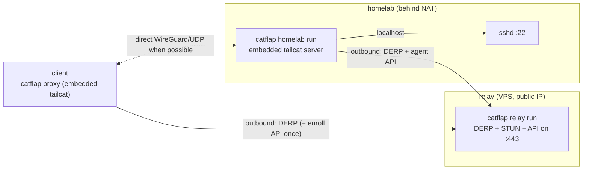

# catflap v1 design

Status: **agreed direction, implementation in progress** (2026-11-14).
catflap v1 replaces an earlier bash/python prototype (not part of this repository).

## Goals

- **One binary**, `catflap`, that sets up every role: relay, homelab, client.
- **Three commands** for the whole setup: `catflap setup relay`, `catflap setup homelab`, `catflap enroll`.
- **Nothing to run besides catflap**: no derper build, no tailcat install, no ntfy, no Cloudflare.
- **Works in locked-down networks**: everything a client needs goes over TCP 443.
- **At least as secure as the prototype**, ideally more (see [Security changes](#security-changes-vs-the-prototype)).

Non-goals for v1: a GUI, multiple relays per homelab, Windows/macOS homelabs, running the relay anywhere but Linux.

## Roles and platforms

| Role | Command | Platforms | Runs as |
|---|---|---|---|
| relay | `catflap setup relay` | Linux amd64/arm64/32-bit ARM (systemd) | system service, dedicated user `catflap` |
| homelab | `catflap setup homelab` | Linux amd64/arm64/32-bit ARM, e.g. a Raspberry Pi (systemd user service + linger); macOS (launchd) later | your normal user, no root |
| client | `catflap enroll` | macOS arm64, Linux amd64/arm64/32-bit ARM, Windows amd64/arm64 | your normal user, no service |

The **homelab is the admin**: `catflap invite`, `list`, `remove` run there. After `setup relay`, nobody needs root SSH to the relay for day-to-day work.

## Why Go, and what is embedded

- **tailcat is a Go library** (`github.com/tailscale/tailcat`). catflap embeds it on the homelab (server) and on clients (dialer). No separate tailcat install. That matters because tailcat ships no macOS binary.
- **tailcat's `Server.AllowClient` hook** asks catflap about each new client at connect time. Adding or removing a device changes an in-memory set. No restarts, no `--allow=""` (allow-everyone) trap, no reconnect flakiness. `Server.DisconnectClient` cuts off a removed device right away.
  - Needs tailcat after v0.7.0. Until v0.8 is released, catflap pins a main commit (`go.mod`).
- **The DERP server is embedded** in the relay (`tailscale.com/derp/derpserver` + `tailscale.com/net/stunserver` + Let's Encrypt via `autocert`). DERP, the enrollment API and the admin API share **port 443**. The relay needs no Go toolchain and no derper build.
  - Cost: catflap owns the ~200 lines of glue that upstream `cmd/derper` contains (TLS, timeouts, meta cert). We copy upstream's settings and keep them in step when we bump `tailscale.com`.
  - tailcat already depends on `tailscale.com`, so both sides always use the same version.
- Static builds (`CGO_ENABLED=0`) for all six targets via goreleaser. 32-bit ARM is built for ARMv6 (`GOARM=6`), which also runs on ARMv7: every Raspberry Pi with a 32-bit OS, down to Pi 1 and Zero.

## Big picture



## Security model

The gates from the prototype stay, plus a stronger enrollment:

| Gate | Where | Decides |
|---|---|---|
| 1 relay admission | relay, in-process | may this node key use the relay at all? |
| 2 tailcat allowlist | homelab, `AllowClient` hook | may this node key open a tunnel? |
| 3 SSH keys | homelab sshd, `~/.ssh/authorized_keys` | may this person log in? |
| + PSK | tailcat address | only holders of the (private) address can handshake |

**The relay never decides on its own who gets in.** It admits keys at gate 1 only when an authenticated homelab says so. Gates 2 and 3 live on the homelab. A fully compromised relay can let strangers *talk to the relay*, but it can't add a device to your homelab, and it can't read invites or the homelab address.

### Bootstrap: join code (relay → homelab)

1. `setup relay` generates a **join code** `cfj1-<id>-<secret>@relay.example.com`: 128-bit secret, one use, valid 1 h. The relay stores only `sha256(secret)`.
2. `setup homelab --join <code>` calls `POST /v1/agent/join` with the secret and the homelab's tailcat node key.
3. The relay creates an **agent** record and returns a random 256-bit **agent token**. It keeps only the token's hash and admits the homelab's node key at gate 1.
4. The homelab stores the token (mode 600). Every agent call uses `Authorization: Bearer <token>`.

A new join code: `sudo catflap relay join-code` on the relay.

### Enrollment: invite codes (default)

```
homelab$ catflap invite office-laptop           # default: valid 15 min, one use
laptop$  catflap enroll cfi1-<id>-<secret>@relay.example.com
```

Crypto (all keys from the invite's 128-bit `secret` via HKDF-SHA256, salt `catflap-invite-v1`):
- `mac_key = HKDF(secret, info="mac")`, `seal_key = HKDF(secret, info="seal")`
- The client sends `POST /v1/enroll {invite_id, nodekey, sshkey, hostname, nonce, mac}` where
  `mac = HMAC-SHA256(mac_key, "catflap-enroll-v1\n" + invite_id + "\n" + nodekey + "\n" + sshkey + "\n" + hostname + "\n" + nonce)`.
- The relay **does not know the secret**. It only checks that `invite_id` was registered by an agent and is still open, then queues the submission (max 5 per invite).
- The homelab agent picks up the submission (long poll), verifies the MAC, and enforces one use and the expiry. Then, in this order:
  1. Gate 2: add the node key to the live allowlist.
  2. Gate 3: add the SSH key to `authorized_keys`, tagged `catflap:<name>`.
  3. Answer `POST /v1/agent/result`, which atomically admits the key at gate 1, closes the invite, and stores a **sealed reply** for the client.
- Sealed reply = AES-256-GCM(`seal_key`) over `{name, tailcat address, ssh user}`, with the invite id, submission id and node key as associated data. The client polls `GET /v1/enroll/<invite>/<submission>`, decrypts, and thereby knows the reply really came from the homelab.

What this buys:
- **No human code comparison.** The MAC binds the keys end to end, so a relay or proxy that swaps keys fails verification.
- **The tailcat address never travels in clear and never needs a public TXT record.** The PSK stays private.
- **No third party** in the trust path.

Residual risks (documented for users):
- **An invite is a bearer secret until it's used.** Whoever enrolls first with it gets the slot, which is why invites are short-lived, one use and bound to a name. `catflap list` shows every device. `catflap invites` lists and revokes open invites.
- **Break-glass invites** (`--ttl 30d`) are for a password manager only.

### Notifications and the Telegram invite bot (v0.2)

For "new laptop, away from home, only my phone at hand", and to notice when something happens that you didn't do.

The prototype's lesson: the notification is easy, **the way back is hard**. Its ntfy Approve button called the homelab, which needed a self-hosted ntfy, a Cloudflare tunnel and ntfy.sh for iOS push. v0.2 opens nothing: every channel is an outgoing HTTPS request from the homelab, and the bot long-polls Telegram.

- **Channels** (`catflap notify add …`, homelab only): `ntfy` (ntfy.sh or your own server; a random topic name is suggested because ntfy.sh topics are readable by name; optional access token), `pushover`, `telegram`, and `command` (runs a program of your choice, no shell, with the message on stdin and `CATFLAP_EVENT/TITLE/MESSAGE/PRIORITY` in the environment, e.g. for mail). Channels are compiled in; a "plugin" is a channel type in the config.
  - Stored in `notify.json` next to the homelab state (600, it holds tokens). Tokens are only ever read from a prompt or stdin, never from the command line, and never printed.
  - A channel goes live only after its test message got through (`notify add` sends one; `notify test` re-checks all).
  - Messages go out in the background with three attempts per message, so a broken channel never holds up the homelab. Errors never contain the Telegram URL (it holds the bot token).
- **Alerts**, to every channel: device enrolled (high priority, with the remove command), device removed, invite created, **failed enrollment** (tampered, expired or reused invite: someone trying something), relay unreachable for 10 minutes and reachable again, and a stranger writing to the bot. A request that came from the bot is answered in Telegram, so its alert goes only to the other channels.
- **Telegram invite bot** (flow B): `/invite <name>`, `/invites`, `/revoke <name>`, `/list`, `/remove <name>`, `/status`.
  - **One chat only.** `notify add telegram` links the chat that opens `t.me/<bot>?start=<one-time code>`; a stranger can't link instead. Everyone else is ignored, and the first message per stranger per hour triggers a high-priority alert on all channels.
  - Bot invites are valid for **15 minutes**. The reply shows `catflap enroll <code>` in a code block (tap to copy). Once used, the bot edits the message to "used"; when the invite expires or is revoked, it deletes the message.
  - `/remove` asks first (inline buttons, valid 5 minutes, single use): a stolen laptop can be cut off from the phone in seconds.
  - Commands that arrived while the homelab was offline (older than 2 minutes) are not executed; the bot says so.
  - **What Telegram sees:** bot chats aren't end-to-end encrypted, so Telegram can read the invite. It works once, for 15 minutes, and is deleted after use. A Telegram account takeover could mint invites, which is why the alerts on your other channels matter: configure ntfy or Pushover too, and you see every invite and enrollment there.
  - Nothing changes on the relay or the clients.

### Tap-to-approve enrollment (later, flow A)

Same need, phone UX without copying a code: the laptop runs `catflap enroll --request <homelab>@relay.example.com`, your phone shows "laptop wants to join, code 482913 [Approve]" through any channel above, and the Approve link goes to the relay (the relay stores only the token's hash; the homelab learns of the approval by polling the relay). The client and the homelab each compute the **pairing code** from the keys. It needs a public request endpoint on the relay with rate limits, so it comes after the invite bot has proven itself; off by default.

### Removal

`catflap remove <name>` on the homelab removes the key from the live allowlist and calls `DisconnectClient` (gate 2, immediate). It also removes the `authorized_keys` line (gate 3) and calls `POST /v1/agent/revoke` (gate 1). If the relay is unreachable, the revocation is queued and retried; gates 2 and 3 are already closed.

### Security changes vs the prototype

| Area | Prototype | v1 |
|---|---|---|
| Who can approve a device | anyone who sees the ntfy approval token (ntfy, Cloudflare, ntfy.sh) | only someone holding the invite secret |
| Key swap protection | you compare a 6-digit code | cryptographic MAC, enforced by the homelab |
| Homelab address | public TXT record (PSK published) | delivered encrypted; TXT not needed |
| Daily admin | root SSH to relay + SSH to homelab | homelab only; relay API scoped per agent |
| Revocation | edit files, restart tailcat | instant, live allowlist + disconnect |
| Relay ports | 443, 80, 3478/udp, 8443 | 443 (+ 80 for ACME/redirect, + 3478/udp for STUN, both optional) |
| Supply chain | `go install derper@latest` on the relay | one signed binary with checksums; no build on the relay |

## Components

```
catflap setup relay   --hostname H [--email E] [--cert-mode letsencrypt|manual] [--no-firewall]
catflap relay run                       # systemd entry point
catflap relay join-code [--ttl 1h]      # print a new join code
catflap relay status

catflap setup homelab --join CODE [--name N] [--forward PORT[=HOST:PORT]]...
catflap homelab run                     # systemd user service entry point
catflap invite NAME [--ttl 15m]
catflap invites [--revoke ID]
catflap list
catflap remove NAME
catflap forward add PORT[=HOST:PORT]... # live, no restart; target default 127.0.0.1:PORT
catflap forward remove PORT...          # also cuts open connections on that port
catflap forward list
catflap notify add telegram|ntfy|pushover|command [--name N]   # prompts for tokens
catflap notify list | remove NAME | test [NAME]

catflap enroll INVITE [--alias homelab] [--ssh-key FILE.pub] [--no-ssh-config]
catflap proxy ALIAS [PORT]              # ssh ProxyCommand: stdio <-> homelab port (default 22)
catflap forward ALIAS [LOCAL:]PORT      # localhost:LOCAL <-> forwarded homelab port (e.g. Node-RED)
catflap forget ALIAS
catflap status
catflap version
```

### Relay (`catflap relay run`)

- Port 443: TLS (Let's Encrypt via autocert, TLS-ALPN-01 or HTTP-01; or a manual cert). Routes:
  - `/derp` (+ WebSocket), `/derp/probe`, `/derp/latency-check`, `/generate_204` (as derper)
  - `/v1/enroll…` (public, rate-limited), `/v1/agent/…` (agent token)
  - `/` blank page
- Port 80 (optional): ACME HTTP-01 + redirect. UDP 3478 (optional): STUN.
- Admission: derpserver only supports a URL hook, so catflap serves it on an in-process loopback listener, **fail closed**.
- Upstream derper's settings are copied: 30 s read/write timeouts (cleared on hijack), TLS ≥ 1.2, `ModifyTLSConfigToAddMetaCert`, TCP keepalive.
- Files: `/etc/catflap/relay.json` (settings), `/var/lib/catflap/state.json` (DERP key, agents, allowlist, open invites, join codes; hashes only), `/var/lib/catflap/certs/`.
- Limits: 64 KB request bodies, per-IP rate limit on `/v1/enroll`, max 5 submissions per invite, max 50 open invites per agent, agent long poll ≤ 25 s.

### Homelab (`catflap homelab run`)

- Embedded `tailcat.Server` with a persistent key and PSK, the relay as its only DERP region, and `AllowClient` backed by the device list.
- Forwards (default only `22 → 127.0.0.1:22`): each forward is a `tailcat.Server.Listen` listener. Connections to any other port get an immediate TCP reset (`OnTCP` is nil). Unlike `tailcat serve all`, nothing else is reachable.
  - Reset rather than silent drop: only enrolled devices can send packets at all (`AllowClient`), and they learn nothing a connection attempt wouldn't tell them anyway. In return a client knows at once that a port isn't forwarded, and silence always means the tunnel itself is stuck, which the client agent relies on (see below).
  - `catflap forward add/remove` changes forwards through the control socket while the daemon runs: the listener opens or closes immediately, no tunnel restart. `remove` also closes connections still open on that port.
  - Forwards are saved in `homelab.json`; only its `forwards` key is rewritten, so other hand edits survive. An explicit `"forwards": {}` means no ports at all.
  - A target may be another machine in the homelab's LAN (`8080=192.168.1.50:80`). Only enrolled devices can reach any forward; the homelab connects to the target as itself.
- Agent loop: long-polls the relay for submissions, verifies, admits, retries queued revocations.
- Control socket (`~/.local/state/catflap/control.sock`, mode 600) for `invite`, `invites`, `list`, `remove`, `forward`, `notify`, `status`. The daemon is the only writer of its state.
- Notifications and the Telegram bot run inside the daemon (see [above](#notifications-and-the-telegram-invite-bot-v02)).
- Files: `~/.config/catflap/homelab.json` (settings: relay, forwards), `~/.local/state/catflap/homelab-state.json` (600: server key, PSK, agent token, devices, invites), `~/.local/state/catflap/notify.json` (600: notification channels and their tokens).

### Client

- `enroll`:
  - Creates the client identity (tailcat node key) and picks an SSH public key: given, `~/.ssh/id_ed25519.pub`, or a new `~/.ssh/catflap_ed25519` made by `ssh-keygen`, so you choose a passphrase.
  - Runs the invite protocol and saves the server entry.
  - Writes an `~/.ssh/config` block between markers:

```
# >>> catflap homelab (managed by catflap, do not edit)
Host homelab
  User <ssh user>
  HostKeyAlias catflap-homelab
  ProxyCommand "/path/to/catflap" proxy homelab
  IdentityFile ~/.ssh/catflap_ed25519      # only if catflap created it
  ServerAliveInterval 30
# <<< catflap homelab
```

  After that, `ssh homelab`, `scp`, `rsync`, VS Code Remote-SSH etc. all just work, on Windows too (built-in OpenSSH).
- `forward ALIAS [LOCAL:]PORT`: listens on **127.0.0.1 only** and tunnels each connection to that homelab port, until Ctrl-C. It checks the port once at start and says so if the homelab doesn't forward it. Binding to the LAN is deliberately not offered: anyone who can reach the listener would use this device's access. (`ssh -L` over `ssh homelab` works too, for ports you don't want to forward on the homelab.)
- Aliases `add`, `remove`, `rm`, `list`, `ls` are reserved (they are `forward` subcommands).
- **Client agent** (`catflap agent`, started on demand, exits after 10 min idle): one tunnel engine per homelab, shared by every `proxy`, `forward` and enroll check of this device. They talk to it over a unix socket next to `client.json` (same directory permissions; AF_UNIX on Windows 10+). Without it, each `ssh`/`scp` would run its own engine with the same device key, and found in testing:
  - a second session froze the first one (relay and homelab see one key hopping between connections);
  - a new session within ~6.5 s after a longer one ended stalled ~10 s (the homelab keeps sending to the old process's UDP port: magicsock's `trustUDPAddrDuration`).
  With the agent, a new session reuses the open tunnel (~0.1–0.3 s). Details:
  - tailcat registers a client with the server ("meow") only on first use, so the agent re-registers before each dial (one packet), and rebuilds its engine if a dial gets no answer for 6 s (a restarted homelab has no WireGuard session with it; WireGuard alone retries only after ~15 s). Measured recovery after a homelab restart: ~7 s.
  - Every request carries the caller's build identity (version, path, size, mtime of the binary). An agent from another build answers "restart", stops accepting, lets its open sessions finish and exits; the caller starts a fresh one.
  - The agent is started detached (new session on Unix; no console, own process group and, where allowed, outside the caller's job object on Windows), so it outlives the ssh process that started it. Log: `agent.log` next to the socket.
  - If the agent can't be used, callers fall back to an engine inside their own process (the old behavior). `CATFLAP_NO_AGENT=1` forces that.
  - Known limit: two homelabs on the **same** relay would still give the agent two engines with the same key.
- Files: `<user config dir>/catflap/client.json` (600: client key, servers). `<user config dir>` is `~/.config` on Linux, `~/Library/Application Support` on macOS and `%AppData%` on Windows.

## Distribution

Details and the release checklist: [releasing.md](releasing.md).

- GitHub Releases built by goreleaser in GitHub Actions on a `v*` tag: plain binaries `catflap_<os>_<arch>[.exe]` (no archives, no version in the name, so `releases/latest/download/…` works), the install scripts, `checksums.txt`, and a GitHub build provenance attestation for every file (`gh attestation verify`).
  - Builds are reproducible: `-trimpath`, file times from the commit, `CGO_ENABLED=0`.
  - Actions are pinned to commit SHAs; the release job alone gets write permissions, the release build doesn't use the Go cache.
- `install.sh` (Linux/macOS, POSIX sh) and `install.ps1` (Windows PowerShell 5.1+): detect OS/arch, download, **verify the SHA-256 against `checksums.txt`**, run the binary once, then install:
  - to `~/.local/bin` (`/usr/local/bin` as root) or `%LOCALAPPDATA%\Programs\catflap` (added to the user PATH, keeping the registry value's type);
  - by rename, so a running catflap keeps its file (Windows: a locked `catflap.exe` is renamed aside and removed on a later run);
  - nothing changes on any failure. The whole script is one function/block, so a truncated `curl | sh` or `irm | iex` runs nothing.
  - Upgrades: same command; the scripts print the restart command for a running relay or homelab service. Clients' agents hand over by build identity on their own.
  - Options via environment: `CATFLAP_VERSION`, `CATFLAP_INSTALL_DIR`, `CATFLAP_REPO`, `CATFLAP_BASE_URL` (mirrors, tests).
- `catflap version` prints version, commit and the embedded tailcat/tailscale versions.

## Testing

- Unit tests: invite/join codes, HKDF/MAC/seal, state handling, authorized_keys editing, ssh config editing.
- **Local end-to-end test** (`tests/e2e.sh`): relay (manual self-signed cert on 127.0.0.1), homelab daemon and client in temp dirs on one machine. It trusts the test cert via `SSL_CERT_FILE` (no insecure flags exist in catflap) and checks:
  - enroll succeeds; a tampered MAC is rejected
  - an expired or reused invite fails
  - a tunnel to a test port works
  - remove cuts off the client immediately
  - an unknown key is rejected by the relay
  - the client agent: two sessions at once both keep working, a reconnect right after a session is fast, the no-agent fallback works, devices recover after a homelab restart
  - forwards: a port is unreachable until `forward add`, the client `forward` listener reaches it, `forward remove` cuts an open connection and blocks new ones, forwards survive a restart
  - notifications, against fake Telegram/ntfy services (`tests/fakeservices.py`): a channel only goes live after its test message, Telegram links only the chat that sent the one-time code, the token is never shown, `/invite` gives a working invite and the message is edited once used, alerts go to the other channels (not echoed to Telegram), a stranger gets nothing and triggers an alert, a tampered enrollment triggers an alert, `/remove` with its confirm button removes the device
- **Install tests** (`tests/install.sh`, `tests/install.ps1`): the install scripts against a goreleaser snapshot served on localhost: install, upgrade over a running catflap (Windows: locked exe moved aside, cleaned up later), tampered binary and missing checksum refused (existing file untouched), missing release; Windows also checks the PATH entry and its registry type, and restores your PATH afterwards.
- **Docker platform test** (`tests/docker.sh`, local, needs Docker with arm64 emulation): `install.sh` on Alpine (busybox wget), Debian (wget / no downloader), Ubuntu and Fedora, amd64, arm64 and 32-bit ARM (v6, v7), as root and as a normal user, checking the right binary was picked; then the end-to-end test with the amd64, arm64, ARMv7 (Debian) and ARMv6 (Alpine) release binaries (`CATFLAP_BIN`). Emulation doesn't enforce ARMv6-only instructions; `GOARM=6` does.
- CI (`.github/workflows/ci.yml`): `go vet`, unit tests and the end-to-end test on amd64 and native arm64 runners; a release dry run (goreleaser snapshot of all six targets) with the install tests on Linux, macOS and Windows (PowerShell 5.1 and 7), plus shellcheck.

## Milestones

1. **Core:** codes + crypto, relay (DERP + API), homelab daemon, client enroll/proxy, local e2e test.
2. **Setup commands and distribution:** systemd units, `catflap` system user, firewall, linger; install scripts; goreleaser; CI and attested releases. *(done; first published release pending)*
3. **Docs:** rewrite README + docs for v1.
4. **v0.2:** notifications (ntfy, Pushover, Telegram, command) and the Telegram invite bot.
5. **Later:** tap-to-approve enrollment (flow A), macOS homelab (launchd).
