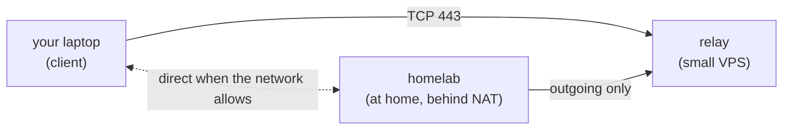

# Getting started

This guide takes you from nothing to `ssh homelab` from anywhere. It takes about 20 minutes,
most of it waiting for DNS.

You set up three things, each with one command:



| Machine | What it does | Needs |
|---|---|---|
| **relay** | meeting point with a public address; passes encrypted traffic, can't read it | a small Linux VPS with systemd and a public IPv4 address, root access, a DNS name |
| **homelab** | the machine you want to reach; decides who gets in | Linux with systemd, macOS or Windows; your normal user; an SSH server (or another service to reach, e.g. Remote Desktop). **No open ports, no router changes.** |
| **client** | laptop, desktop or second machine you connect from | Linux, macOS or Windows; OpenSSH client (built into all three) |

Any cheap VPS works for the relay; 1 vCPU and 512 MB RAM should be plenty. A Raspberry Pi works as
homelab or client, and so does a Mac mini or a Windows PC that stays on.

## 1. Prepare the relay server

1. **DNS:** create an `A` record (and `AAAA` if the VPS has IPv6) for a name like
   `relay.example.com` pointing to the VPS. Let's Encrypt needs it to issue the certificate.
2. **Ports:** allow these in your provider's firewall (if it has one):

   | Port | Why | Required? |
   |---|---|---|
   | 443/tcp | everything: relay, enrollment, admin API | yes |
   | 80/tcp | Let's Encrypt and redirects | recommended |
   | 3478/udp | STUN, lets devices find a direct path | recommended (without it, all traffic goes through the relay) |

   catflap opens them in `ufw` or `firewalld` on the server itself if one of them is active.
3. Nothing else may use port 443 on the server (no web server on it).

## 2. Set up the relay

On the VPS, as root:

```sh
curl -fsSL https://github.com/PaddeK/catflap/releases/latest/download/install.sh | sh
catflap setup relay --hostname relay.example.com
```

It installs a system service (`catflap-relay`) running as its own unprivileged user, gets a
certificate, and prints a **join code**:

```
Next, on your homelab (as your normal user, valid for 1 hour, one use):

  catflap setup homelab --join cfj1-…
```

Copy that line. You don't need root on the relay again for day-to-day work.

<details>
<summary>Options</summary>

- `--email you@example.com`: contact address for Let's Encrypt (expiry warnings).
- `--cert-mode manual --cert FILE --key FILE`: use your own certificate instead of Let's Encrypt.
- `--no-firewall`: don't touch ufw/firewalld.
- `--http-port 0` / `--stun-port 0`: turn off port 80 or STUN.
- `--restore FILE`: set up from a backup instead, when moving a relay to a new server (see
  [Using catflap](using-catflap.md#moving-the-relay-to-another-server)).

A new join code later (e.g. after it expired): `sudo catflap relay join-code`.
</details>

## 3. Set up the homelab

On the homelab, as **your normal user** (not root):

```sh
# Linux / macOS
curl -fsSL https://github.com/PaddeK/catflap/releases/latest/download/install.sh | sh
# Windows (PowerShell)
irm https://github.com/PaddeK/catflap/releases/latest/download/install.ps1 | iex

catflap setup homelab --join cfj1-…
```

This registers the homelab with the relay and starts it as a background service that runs as
you:

| Homelab OS | Service | Good to know |
|---|---|---|
| Linux | systemd **user** service `catflap` | keeps running after you log out ("lingering"); if catflap can't turn that on itself, it prints the one `sudo loginctl enable-linger …` to run |
| macOS | LaunchAgent `catflap.homelab` | runs while you're logged in: after a reboot that means FileVault's unlock at boot or automatic login. SSH needs **Remote Login** (System Settings > General > Sharing) |
| Windows | scheduled task `catflap-homelab` | starts at boot, nobody needs to log in. Setting it up asks once for admin rights (UAC). SSH needs the **OpenSSH Server** (Settings > System > Optional features); without it, forward Remote Desktop instead: `--forward 3389` |

setup tells you if nothing answers on a forwarded port yet, e.g. no SSH server.

On Windows, if your account is an administrator (the first account on a PC usually is), the
homelab runs **elevated**: Windows' SSH server reads admins' keys only from
`C:\ProgramData\ssh\administrators_authorized_keys`, which only an elevated process can change.
See [Security](security.md#windows-homelab) for what that means.

By default only SSH (port 22) is reachable through catflap. More ports come later with
`catflap forward add`, see [Using catflap](using-catflap.md#more-ports-forwards).

<details>
<summary>Options</summary>

- `--name office`: name of this homelab; it becomes the `ssh` alias on clients (default `homelab`).
- `--forward 22 --forward 1880`: ports to expose from the start (`PORT` or `PORT=HOST:PORT`).
</details>

## 4. Add your first device

On the homelab, create an invite named after the device:

```sh
catflap invite laptop
```

```
Invite for "laptop" (one use, valid until 2026-11-15 14:32):

  catflap enroll cfi1-…@relay.example.com
```

The invite is valid for 15 minutes and works once. Treat it like a password until it's used.

(No access to the homelab right now? With the Telegram bot set up, a new device can also ask to
join and you approve it with a tap: see [Using catflap](using-catflap.md#approve-a-new-device-from-your-phone-no-invite).)

On the laptop, install catflap and run the `enroll` line:

```sh
# Linux / macOS
curl -fsSL https://github.com/PaddeK/catflap/releases/latest/download/install.sh | sh
catflap enroll cfi1-…@relay.example.com
```

```powershell
# Windows (PowerShell)
irm https://github.com/PaddeK/catflap/releases/latest/download/install.ps1 | iex
catflap enroll cfi1-…@relay.example.com
```

`enroll`:
- creates this device's keys and sends your SSH public key (`~/.ssh/id_ed25519.pub`; if you have
  none, it creates `~/.ssh/catflap_ed25519` and asks for a passphrase);
- waits for the homelab to approve (a few seconds);
- adds a `Host homelab` block to your `~/.ssh/config`;
- checks that the tunnel works.

<details>
<summary>Options</summary>

On the laptop, for `catflap enroll`:

- `--alias NAME`: the `ssh` alias for this homelab (default: the homelab's name, e.g. `homelab`).
  Useful if the name is taken in your `~/.ssh/config`, or for a second homelab. `add`, `remove`,
  `rm`, `list` and `ls` can't be used (they're `catflap forward` commands).
- `--ssh-key FILE.pub`: the SSH public key to authorize on the homelab, instead of
  `~/.ssh/id_ed25519.pub`.
- `--no-ssh-key`: don't send an SSH key; you manage `authorized_keys` on the homelab yourself.
- `--no-ssh-config`: don't touch `~/.ssh/config`. Then connect with
  `ssh -o ProxyCommand='catflap proxy homelab' USER@homelab`.

On the homelab, for `catflap invite`:

- `--ttl 2h`: keep the invite valid longer than 15 minutes (up to 90 days), e.g. for a device
  you set up later today. Long-lived invites belong in a password manager.
- `--replace`: enroll an existing device again (e.g. after reinstalling it); its old entry and
  SSH key are replaced.
</details>

## 5. Connect

```sh
ssh homelab
```

That's it, from any network. `scp`, `rsync`, `git` over SSH and editors like VS Code's
Remote-SSH all work with the `homelab` alias, because it's a normal SSH config entry.

The SSH key catflap added to the homelab only works through catflap, not over your LAN. Your
existing keys and logins on the homelab are untouched.

## Next steps

- [Using catflap](using-catflap.md): more devices, more ports (e.g. a web UI), phone alerts and
  the Telegram bot, upgrades.
- [Security](security.md): what protects your homelab, and what to do if a device is lost.
- [Troubleshooting](troubleshooting.md) if something doesn't work.
