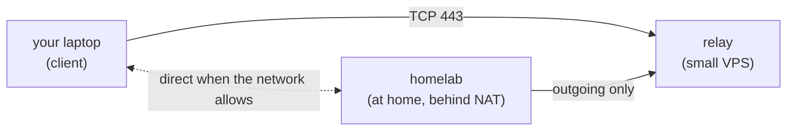

# Getting started

This guide takes you from nothing to `ssh homelab` from anywhere. It takes about 20 minutes,
most of it waiting for DNS.

You set up three things, each with one command:



| Machine | What it does | Needs |
|---|---|---|
| **relay** | meeting point with a public address; passes encrypted traffic, can't read it | a small Linux VPS with systemd and a public IPv4 address, root access, a DNS name |
| **homelab** | the machine you want to reach; decides who gets in | Linux with systemd, macOS or Windows; your normal user; an SSH server (or another service to reach, e.g. Remote Desktop). **No open ports, no router changes.** |
| **client** | laptop, desktop or second machine you connect from | Linux, macOS or Windows; OpenSSH client (built into all three) |

Any cheap VPS works for the relay; 1 vCPU and 512 MB RAM are plenty. A Raspberry Pi works as
homelab or client, and so does a Mac mini or a Windows PC that stays on.

## 1. Prepare the relay server

1. **DNS:** create an `A` record (and `AAAA` if the VPS has IPv6) for a name like
   `relay.example.com` pointing to the VPS. Let's Encrypt needs it to issue the certificate.
2. **Ports:** allow these in your provider's firewall (if it has one):

   | Port | Why | Required? |
   |---|---|---|
   | 443/tcp | everything devices and homelabs need: relayed traffic, enrollment, the homelab's connection | yes |
   | 80/tcp | Let's Encrypt and redirects | recommended |
   | 3478/udp | STUN: helps devices find a direct path to the homelab | recommended (without it, all traffic goes through the relay) |

   catflap opens them in `ufw` or `firewalld` on the server itself if one of them is active.
3. Nothing else may use port 443 on the server (no web server on it).

## 2. Set up the relay

On the VPS, as root:

```sh
curl -fsSL https://github.com/PaddeK/catflap/releases/latest/download/install.sh | sh
catflap setup relay --hostname relay.example.com
```

It installs a system service (`catflap-relay`) running as its own unprivileged user, gets a
certificate, and prints a **join code**:

```
Next, on your homelab (as your normal user, valid for 1 hour, one use):

  catflap setup homelab --join cfj1-…
```

Copy that line. Treat it like a password: anyone who has it can register a homelab on your
relay within the next hour.

Day-to-day work (devices, ports, alerts) happens on the homelab. You only log in to the relay
again to upgrade it, back it up or add another homelab.

<details>
<summary>Options</summary>

- `--email you@example.com`: contact address for Let's Encrypt (expiry warnings).
- `--cert-mode manual --cert FILE --key FILE`: use your own certificate instead of Let's Encrypt.
- `--no-firewall`: don't touch ufw/firewalld.
- `--http-port 0` / `--stun-port 0`: turn off port 80 or STUN.
- `--restore FILE`: set up from a backup instead, when moving a relay to a new server (see
  [Using catflap](using-catflap.md#moving-the-relay-to-another-server)).

`catflap setup relay -h` lists every option. A new join code later (e.g. after it expired):
`sudo catflap relay join-code`.
</details>

## 3. Set up the homelab

On the homelab, as **your normal user** (not root):

```sh
# Linux / macOS
curl -fsSL https://github.com/PaddeK/catflap/releases/latest/download/install.sh | sh
# Windows (PowerShell)
irm https://github.com/PaddeK/catflap/releases/latest/download/install.ps1 | iex

catflap setup homelab --join cfj1-…
```

If your shell then says `catflap: command not found`: the installer printed where it put
catflap (usually `~/.local/bin`). Open a new terminal, add that folder to your PATH, or run
catflap by its full path, e.g. `~/.local/bin/catflap`.

`setup homelab` registers the homelab with the relay and starts it as a background service that
runs as you:

| Homelab OS | Service | Good to know |
|---|---|---|
| Linux | systemd **user** service `catflap` | systemd normally stops your services when you log out; catflap turns on "lingering" so it keeps running. If it can't do that itself, it prints the `sudo loginctl enable-linger …` command to run once. |
| macOS | LaunchAgent `catflap.homelab` | Runs only while you're logged in. After a reboot it starts once you log in: with FileVault, unlocking the disk at boot counts; without FileVault, turn on automatic login. SSH needs **Remote Login** (System Settings > General > Sharing). |
| Windows | scheduled task `catflap-homelab` | Starts at boot, nobody needs to log in. Setting it up asks once for admin rights (UAC). SSH needs the **OpenSSH Server** (Settings > System > Optional features); without it, forward Remote Desktop instead: `--forward 3389`. |

`setup homelab` tells you if nothing answers on a forwarded port yet, e.g. because no SSH server
runs.

On Windows, if your account is an administrator, the homelab runs with admin rights: Windows'
SSH server requires that for administrators' keys. See [Security](security.md#windows-homelab)
for what that means.

By default only SSH (port 22) is reachable through catflap. More ports come later with
`catflap forward add`, see [Using catflap](using-catflap.md#more-ports-forwards).

<details>
<summary>Options</summary>

- `--name office`: name of this homelab; it becomes the `ssh` alias on clients (default `homelab`).
- `--forward 22 --forward 1880`: ports to expose from the start (`PORT` or `PORT=HOST:PORT`).
</details>

## 4. Add your first device

On the homelab, create an invite named after the device:

```sh
catflap invite laptop
```

```
Invite for "laptop" (one use, valid until 2026-11-15 14:32):

  catflap enroll cfi1-…@relay.example.com
```

The invite works once and is valid for 15 minutes (`--ttl 2h` for longer). Treat it like a
password until it's used.

(No access to the homelab right now? With the Telegram bot set up, a new device can also ask to
join and you approve it with a tap: see [Using catflap](using-catflap.md#approve-a-new-device-from-your-phone-no-invite).)

On the laptop, install catflap and run the `enroll` line:

```sh
# Linux / macOS
curl -fsSL https://github.com/PaddeK/catflap/releases/latest/download/install.sh | sh
catflap enroll cfi1-…@relay.example.com
```

```powershell
# Windows (PowerShell)
irm https://github.com/PaddeK/catflap/releases/latest/download/install.ps1 | iex
catflap enroll cfi1-…@relay.example.com
```

`enroll`:
- creates this device's keys and sends your SSH public key (`~/.ssh/id_ed25519.pub`; if you have
  none, it creates `~/.ssh/catflap_ed25519` and asks for a passphrase);
- waits for the homelab to accept the device (a few seconds);
- adds a `Host homelab` block to your `~/.ssh/config`;
- checks that the tunnel works.

To pick another SSH key or alias, or leave your ssh config alone, see the
[enroll options](using-catflap.md#enroll-options).

## 5. Connect

```sh
ssh homelab
```

That's it, from any network. `scp`, `rsync`, `git` over SSH and editors like VS Code's
Remote-SSH all work with the `homelab` alias, because it's a normal SSH config entry.

The first connection takes a second or two; catflap then keeps the tunnel open in the background
for the next ones (the **catflap agent**, which exits by itself after 10 minutes without use).

catflap adds your key to the homelab's `authorized_keys` with a restriction: that entry only
works through catflap, not over your LAN. Your existing keys and logins on the homelab are
untouched.

## Words used in these guides

| Word | Meaning |
|---|---|
| **join code** (`cfj1-…`) | one-time code from the relay that registers a homelab with it |
| **invite** (`cfi1-…`) | one-time code from the homelab that lets one device enroll |
| **enroll** | a device joining a homelab, with an invite or an approved request |
| **request window** | a time you open on the homelab during which new devices may ask to join without an invite |
| **forward** | a homelab port (or a port of another machine in its network) made reachable through catflap |
| **catflap agent** | the small background process on a client that keeps the tunnel open between connections |

## Next steps

- [Using catflap](using-catflap.md): more devices, more ports (e.g. a web UI), phone alerts and
  the Telegram bot, upgrades.
- [Security](security.md): what protects your homelab, and what to do if a device is lost.
- [Troubleshooting](troubleshooting.md) if something doesn't work.
